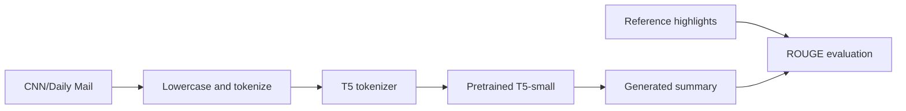

# T5 Text Summarization

**A notebook experiment in abstractive summarization using pretrained T5-small and CNN/Daily Mail articles.**

[Open the notebook](text-summarization.ipynb) · [Portfolio](https://github.com/Frey-Lee-6)

## Overview

This project explores how a text-to-text transformer can generate a shorter version of a news article, and how that output can be compared with a reference summary.

The notebook loads a news dataset, performs text preprocessing, runs pretrained T5-small inference, and computes ROUGE scores for a sample. It is an exploratory inference and evaluation workflow. A model-training loop and a held-out benchmark have not yet been added.

## Workflow



## Implementation details

| Component | Current notebook configuration |
| --- | --- |
| Dataset | Hugging Face Datasets, `cnn_dailymail`, configuration `1.0.0` |
| Model | `t5-small`, loaded with `T5ForConditionalGeneration` |
| Tokenizer | `T5Tokenizer` |
| Text preprocessing | Lowercasing and NLTK word tokenization |
| Input length | Truncated to a maximum of 512 tokens |
| Generation | Maximum length 150, four beams, length penalty 2.0, early stopping |
| Evaluation | ROUGE-1, ROUGE-2, and ROUGE-L with stemming |

The current `summarize(text)` function tokenizes an article, generates output IDs, and decodes the generated summary. The evaluation function compares the generated text with the dataset's reference highlights.

## Environment

The notebook metadata records Python 3.11.9. The dependencies are currently unpinned. A starting environment can be created with the following commands.

```sh
git clone https://github.com/Frey-Lee-6/nlp-text-summarizer.git
cd nlp-text-summarizer
python -m venv .venv
```

Activate the environment using the appropriate command for your shell.

```powershell
# Windows PowerShell
.\.venv\Scripts\Activate.ps1
```

```sh
# macOS or Linux
source .venv/bin/activate
```

```sh
python -m pip install jupyterlab torch transformers datasets nltk rouge-score sentencepiece
jupyter lab
```

Open `text-summarization.ipynb`. The notebook downloads NLTK resources, dataset files, and model assets, so the first run requires network access. Compatibility with current package and dataset versions has not been revalidated.

## Running the existing notebook

The notebook preserves an exploratory workflow with a saved-dataset step. To use it on a new machine, account for the following details.

1. Load the dataset and run preprocessing, or supply a compatible dataset saved on disk.
2. The cell containing `load_from_disk('processed_dataset')` expects that directory to exist. If you have just created `dataset` in memory, skip the load-from-disk cell or save the dataset first.
3. Load T5-small and its tokenizer.
4. Run the cell defining `summarize` and generating the first article's summary.
5. Run the ROUGE evaluation cell.
6. If you change `sample_text` to another article, regenerate the summary and select that same article's reference before evaluating.

For example, after the functions and dataset are loaded, keep the sample index consistent.

```python
sample_index = 1
sample_text = dataset["train"][sample_index]["article"]
reference_summary = dataset["train"][sample_index]["highlights"]

generated_summary = summarize(sample_text)
evaluation = evaluate_summary(generated_summary, reference_summary)
print(generated_summary)
print(evaluation)
```

## Interpreting the results

The saved workflow evaluates a sample from the training split. That provides an example of the evaluation code, but it does not establish performance on unseen data. There is no verified aggregate result table in this release.

The 512-token input limit can discard part of a long article. The current function also passes text directly without an explicit `summarize:` task prefix. Both choices should be examined when establishing a reproducible T5 baseline.

## Next steps

- Make the dataset preparation and caching steps reproducible.
- Record dependency versions and a fixed evaluation subset.
- Compare preprocessing choices and task-prefix handling.
- Add an extractive baseline and aggregate ROUGE results on held-out examples.
- Review factual consistency and examples where the model omits important information.

## References

- The model architecture and text-to-text formulation are described in the [T5 paper](https://arxiv.org/abs/1910.10683).
- Dataset details are available in the [CNN/Daily Mail dataset card](https://huggingface.co/datasets/abisee/cnn_dailymail).
